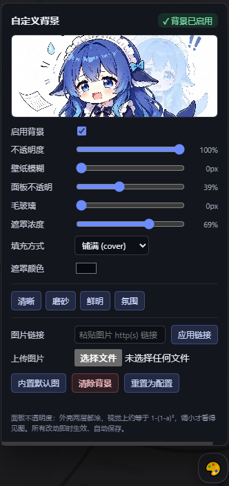

# dsh-shell-wallpaper

[简体中文](#简体中文) · [English](#english) · [纯中文版](./docs-zh-CN.md)

## 简体中文

给整个 DeepSeek Harness 界面铺一张背景图，并自带一个「边拖边生效」的独立控制面板。

**插件内置一张默认图**（`assets/default-bg.jpg`），所以全新安装、零配置就能看到背景。用户随时可以换成任意图片（上传 / URL / 本地路径），也可一键切回内置图。

结构上分两半：host 端只通过 HTTP 服务一个文件外加一个 `/info` 描述；client 端把它画到外壳背后、轮询该描述、并画一个浮动 🎨 面板。不依赖 Wallpaper Engine、不处理视频、没有玻璃管线 —— DSH 自带主题和已装的皮肤插件根本不支持 `background-image`，所以这是能跑起来的最小实现。

**为什么面板由我们自己画，而不是交给设置框架**：`dsh-settings` 自己的 README 写着「autoGenerate … 目前没有已发布的客户端这样做」——实时设置服务会发布 schema，但没有任何已发布客户端据此渲染页面。而在这个 profile 上注册自定义设置 slot 曾经导致过整页白屏。所以面板是我们已经验证可用的 client bundle 注入的纯 DOM，包在独立的 `try/catch` 里：它坏了只坏面板，背景照常铺，GUI 不会白屏。

### 安装

从 npm 安装（推荐）：

```powershell
dsh plugin --profile desktop add dsh-shell-wallpaper
```

从源码目录安装（`dsh plugin add 'file:…'` 要求传**绝对路径**）：

```powershell
dsh plugin --profile desktop add 'file:<你克隆这个仓库的目录>'
```

或者直接从 GitHub 仓库装：

```powershell
dsh plugin --profile desktop add 'github:1020252969/dsh-wallpaper'
```

> `dsh` 是宿主自带的 CLI。它可能不在 `PATH` 里，那就用完整路径调用，
> 例如 `& '<DSH 安装目录>\resources\runtime\cli\bin\dsh.cmd' plugin …`。
> `--profile` 换成你自己的 profile 名（默认 profile 是 `desktop`）。

**无需任何配置** —— 自动使用内置的 `assets/default-bg.jpg`。若要指向自己的文件或设定默认值，把配置写进该 profile 的 `cordis.patch.yml`（即 `$DSH_HOME/profiles/<profile>/cordis.patch.yml`）。**必须写完整一整块** —— patch 的一行会整体替换该行的 config，写半块会把缺的键静默重置为默认值：

```yaml
- id: wallpaper
  config:
    enabled: true
    imagePath: ''            # 空 = 用内置默认图
    opacity: 1
    blur: 0
    panelAlpha: 0.35
    backdropBlur: 0
    fill: cover
    scrimColor: '#08090e'
    scrimAlpha: 0.5
```

装完 bundle 后刷新一次页面（client bundle 在页面加载时注入）。之后**全部实时生效**，不用再刷新。

### 控制面板

点右下角 🎨 按钮，面板长这样：



面板包含：

- **状态徽标**（`✓ 背景已启用` / `✗ 已关闭` / `未配置` / `文件缺失`）和**实时预览缩略图**；
- **启用**复选框；
- 五个滑杆 —— 不透明度、壁纸模糊、面板透明、毛玻璃模糊、遮罩浓度 —— 各自显示当前值；
- **填充方式**（铺满 / 完整）、**遮罩颜色**选择器；
- 四档**预设**（清晰 / 磨砂 / 鲜明 / 氛围）；
- **上传**本地图片（JPG/PNG/GIF/WebP/BMP/AVIF），或**粘贴 http(s) 链接**后点「应用链接」；
- **内置默认图** —— 切回插件自带图（同时重新启用背景）；
- **清除背景**（关闭）与**重置为配置**（丢弃所有面板改动）。

每个控件都写 `POST /wallpaper/api/config`，约一秒内就能看到变化，因为绘制端在轮询 `/info`。

#### 改动存在哪

面板改动写进 `<wallpaper-dir>/settings.json`（默认 `$DSH_HOME/wallpaper/settings.json`，例如 `~/.dsh/wallpaper/settings.json`），**不写** `cordis.patch.yml`。这个文件是**叠在 profile patch 之上的覆盖层**：

```
read() = normalizeConfig({ ...plainConfig(profile row), ...await store.load() })
```

由此：改动重启后仍在；拖滑杆不会重写 patch（不会引发 config-reload 风暴）；「重置为配置」只是删掉覆盖文件。目录可用 `config.wallpaperDir` 或环境变量 `DSH_WALLPAPER_DIR` 改（测试用后者隔离到临时目录）。

### 配置项

每个字段都是 `volatile()`，因为实时设置服务只能持久化 volatile 字段 —— 非 volatile 字段会让表单以极难察觉的方式变成只读。（虽然我们自己的面板已不依赖那张表单，导出的 `Config` 仍为兼容保留。）

| 字段 | 含义 | 默认值 |
|---|---|---|
| `enabled` | 关掉整个背景但不删配置。 | `true` |
| `imagePath` | 图片绝对路径，**用正斜杠**。空值使用内置的 `assets/default-bg.jpg`。路径错误会安静地失败（控制台警告 + 原生主题）。 | `''` → 内置图 |
| `opacity` | 0–1，图片图层自身的不透明度。 | `1` |
| `blur` | 0–64 px，作用在图片本身。超过约 24 就只是一片颜色。 | `0` |
| `panelAlpha` | 0–1，外壳表面保留多少不透明度，**这是可读性旋钮**；`1` 会把图完全盖住。因为 `_frame` 与 `_centerCol` 两层嵌套都涂，实际观感接近 `1-(1-a)²`。 | `0.35` |
| `backdropBlur` | 0–64 px，给大的外壳表面加 `backdrop-filter`，得到毛玻璃而非平涂色块；`0` = 关闭。 | `0` |
| `fill` | `cover`（铺满）或 `contain`（完整）。 | `cover` |
| `scrimColor` | 遮罩颜色，`#rrggbb` / `rgb()` / `rgba()`，位于图片与 UI 之间。 | `#08090e` |
| `scrimAlpha` | 0–1，遮罩浓度。 | `0.35` |
| `scrim` | 遗留字段：任意 CSS 颜色，仅在 `scrimColor` 无法解析时启用。 | `''` |

### 原理：为什么不是一行 CSS

外壳会给每一层都涂不透明底色。来自 `@deepseek-ai/dsh-client-ui-layout` 的 `AppFrame.module.css`：

```css
.mP3x-q_frame     { background: var(--dsw-alias-bg-base) }
.mP3x-q_centerCol { background: var(--dsw-alias-bg-base) }
.mP3x-q_sidebarCol{ background: var(--dsw-specific-sidebar-fill) }
[data-windows-titlebar] .mP3x-q_frame { background: var(--dsw-specific-sidebar-fill) }
```

所以 `body` 上的 `background-image` 根本看不见。插件改为：

1. 在 `<body>` 上放一个 `position: fixed; z-index: -1` 的图层；
2. 把 `--dsw-alias-bg-base` 与 `--dsw-specific-sidebar-fill` 重新指向 `color-mix(in srgb, <主题基色> <panelAlpha>%, transparent)`；
3. 在 `body[data-ds-dark-theme][data-dsh-wallpaper]` 下**重复一遍这些覆盖 —— 这正是坑所在**。主题包把自己那套调色板样式表**追加在本插件之后**，而 `body[data-ds-dark-theme]` 特异性同为 (0,1,1) 却排在后面，于是把框架重涂成不透明深色、图片消失。深色选择器把特异性抬到 (0,2,1)。

`<主题基色>` 读自 `getComputedStyle(document.body).backgroundColor`，不是读令牌 —— 令牌通常又是另一个 `var()`，直接取值会拿到字面文本。

布局里的类名是 CSS-module 哈希（`mP3x-q_`），随版本变化，所以这里不按哈希匹配；`--dsw-alias-*` 令牌才是稳定契约。毛玻璃面板也是靠几何而非 CSS 找到：`<body>` 下两层以内、覆盖视口 ≥20%、且背景不透明的节点会被打上 `data-dsh-wp-frost`，样式表只对带该属性的节点应用 `backdrop-filter`。

#### 保持同步与自愈

`GET /wallpaper/api/info` 带一个 `revision` 字符串，任何旋钮或文件变化都会让它改变。客户端约每秒轮询一次（标签页隐藏时暂停），只在它变化时重画 —— 这既让滑杆实时生效，也意味着原地替换图片无需刷新。面对 v1/v2 的 host，同一个值会由客户端本地从响应推导。

宿主是 SPA：切换对话/主题会追加新样式表，可能把两个令牌重涂成不透明，或把我们的 `<style>` 从 `<head>` 里挤掉 —— 表现为「聊着聊着背景变黑」。以前 revision 不变就跳过重画，于是永远恢复不了。现在每个 tick 都会跑 `selfHeal()`（检查样式/图层/标记是否还在，必要时把我们的样式表挪回 `<head>` 末尾，用 `lastGoodInfo` 重画）。`shellBaseColor()` 只缓存完全不透明的基色，避免反复重画把色调越压越暗。

### 接口

| 路由 | 行为 |
|---|---|
| `GET /wallpaper/api/info` | JSON。无图可画时返回 `ok:false` + `reason`（`disabled` / `missing` / `not-a-file`）+ `error`；`cache-control: no-store`。随包带上四档 `presets` 与 `wallpaperDir` 供面板使用。 |
| `GET\|HEAD /wallpaper/api/image` | 流式返回那个配置文件（或内置默认图）。`ETag` + `If-None-Match` → `304`。**没有任何路径参数**，因此无法读取其它文件。 |
| `POST /wallpaper/api/config` | `{...旋钮}` → 白名单过滤 → 写入 `settings.json`。`{reset:true}` 删除覆盖文件。`{useDefault:true}` 清空 `imagePath`（→ 内置图）并重新启用背景。 |
| `POST /wallpaper/api/clear` | 持久化 `{enabled:false}`。 |
| `POST /wallpaper/api/upload` | `{dataBase64}` → magic-byte 嗅探 → 存为 `wallpaper-<时间>-<随机>.<ext>`（忽略客户端文件名）→ 把 `imagePath` 指过去并启用。上限 12 MB。 |
| `POST /wallpaper/api/import-url` | `{url}` → 下载 → 同样的存盘流程。 |

#### URL 导入与 SSRF

`importFromUrl` 刻意做得很严，因为 host 跑在用户自己的机器上：

- 只接受 `http:`/`https:`、URL 里不带凭据、只允许 80/443 端口；
- 抓取前先 `dns.lookup(all)` 解析主机名，**每一个**返回地址都必须通过 `ipIsPrivate()` —— 回环、链路本地、RFC1918、CGNAT、文档保留段、`169.254.169.254` 一类元数据、组播/保留地址，以及 IPv6 `::1`/`fc00::/7`/`fe80::/10`/`::ffff:` 映射地址，一律拒绝；
- 重定向**手动**跟随（`redirect:'manual'`），最多 4 跳，每跳重新校验（防止公网 URL 弹回局域网）；
- 15 秒超时（`AbortController`）；`content-length` 与实际流双重限 12 MB；
- 下载的字节还必须通过 `sniffImage()` —— 绝不按扩展名信任文件。

上传同样严格：`sniffImage()` 只认识 jpg/png/gif/webp/bmp/avif 的真实 magic bytes，其余一律 415；畸形 JSON / 坏 base64 返回 400。

### 已知边界

- **只有一张图。** 没有轮播、没有视频、没有按工作区分别设图。需要这些请装 `dsh-plugin-wallpaper-engine`（1.4.0，约 4.5 MB client bundle + 8 行 host 配置）。
- **实际只适合深色模式。** 遮罩与 `panelAlpha` 默认值是按「深色配色 + 明亮图片」调的；浅色主题下建议 `panelAlpha` 接近 `0.95` 并换更浅的遮罩。
- **毛玻璃面板的判定是启发式的。** 若未来布局把框架嵌到两层以上，就找不到可毛玻璃化的节点，这个设置看起来会像失效。
- **面板是悬浮按钮，不是设置页。** 它刻意独立于设置框架（见开头）。安装后刷新一次页面才会出现。

### 开发

测试运行时需要 `@deepseek-ai/schemastery`，它由宿主 profile 提供。所以源码目录里放了一个 `node_modules` 目录联接（junction），指到你**自己 profile** 的 `node_modules`（把下面的 `<profile>` 换成你的 profile 名，`<DSH_HOME>` 换成你的 DSH 主目录）：

```powershell
New-Item -ItemType Junction -Path '.\node_modules' -Target '<DSH_HOME>\profiles\<profile>\node_modules'
```

然后在仓库目录里跑：

```powershell
node test\host.spec.mjs     # 34 项断言
node test\client.spec.mjs   # 77 项断言
```

client 测试会把 `setInterval` 打桩 —— 真实文件会轮询，不打桩会让 node 永不退出。它还用**薄** DOM（没有 `addEventListener`）跑绘制断言以验证面板优雅降级，用**富** DOM 跑面板断言。host 测试把 `DSH_WALLPAPER_DIR` 指到临时目录，绝不碰真实的 `settings.json`。

### 卸载

```powershell
dsh plugin --profile desktop remove dsh-shell-wallpaper
```

同时把 `cordis.patch.yml` 里的 `- id: wallpaper` 块删掉。没有插件时这行是惰性的（Cordis 会跳过 bundle 缺失的行），但留着就是一份等将来重装时才生效的旧配置。

---

## English

One picture behind the whole DeepSeek Harness GUI, plus a self-contained control panel that takes effect while you drag.

**A default picture ships inside the plugin** (`assets/default-bg.jpg`), so a fresh install shows a wallpaper with zero configuration. The user can switch to any picture at any time (upload / URL / path) and come back to the bundled one with one click.

A small host half (serves exactly one file over HTTP, plus a `/info` descriptor) and a small client half (paints it behind the shell, polls that descriptor, and draws a floating 🎨 panel). No Wallpaper Engine, no video, no glass pipeline — the DSH built-in theme and the installed skin plugins have no background-image support at all, so this is the smallest thing that works.

**Why the panel is drawn by us instead of by the settings framework:** `dsh-settings`' own README says "autoGenerate … currently no shipped client does this" — the live settings service publishes the schema, but no released client renders a page from it. Registering a custom settings slot has also white-screened this profile before. So the panel is plain DOM injected by our already-proven client bundle, in its own `try/catch`: if it breaks, only the panel breaks, the wallpaper still paints and the GUI never white-screens.

### Install

From npm (recommended):

```powershell
dsh plugin --profile desktop add dsh-shell-wallpaper
```

From a checkout (`dsh plugin add 'file:…'` needs an **absolute** path):

```powershell
dsh plugin --profile desktop add 'file:<the directory you cloned this repository into>'
```

Or straight from the GitHub repository:

```powershell
dsh plugin --profile desktop add 'github:1020252969/dsh-wallpaper'
```

> `dsh` is the CLI shipped with the host. It is not necessarily on `PATH` — then call it by
> full path, e.g. `& '<DSH install dir>\resources\runtime\cli\bin\dsh.cmd' plugin …`.
> Replace `--profile desktop` with your own profile name.

**No config is required** — the bundled `assets/default-bg.jpg` is used automatically. If you want to point at your own file or set defaults, add the config to that profile's `cordis.patch.yml` (`$DSH_HOME/profiles/<profile>/cordis.patch.yml`). **Write the whole block** — a patch row replaces the row's entire config, so a partial block silently resets the missing keys to their defaults:

```yaml
- id: wallpaper
  config:
    enabled: true
    imagePath: ''            # empty = the bundled default picture
    opacity: 1
    blur: 0
    panelAlpha: 0.35
    backdropBlur: 0
    fill: cover
    scrimColor: '#08090e'
    scrimAlpha: 0.5
```

Reload the page once after installing the bundle (the client bundle is injected at page load). After that, **everything is live** — no more reloads.

### The control panel

Click the 🎨 launcher in the bottom-right corner. It looks like this:


The panel has:

- a **status badge** (`✓ 背景已启用` / `✗ 已关闭` / `未配置` / `文件缺失`) and a **live preview thumbnail**,
- an **enable** checkbox,
- five sliders — opacity, wallpaper blur, panel alpha, frosted-glass blur, scrim strength — each showing its current value,
- **fill mode** (铺满 / 完整), a **scrim colour** picker,
- four **presets** (清晰 / 磨砂 / 鲜明 / 氛围),
- **upload** a local picture (JPG/PNG/GIF/WebP/BMP/AVIF), or **paste an http(s) URL** and click 应用链接,
- **内置默认图** — switch back to the picture bundled with the plugin (also re-enables the background),
- **清除背景** (switch off) and **重置为配置** (drop all panel changes).

Every control writes through `POST /wallpaper/api/config` and the change shows up within about a second, because the painter polls `/info`.

#### Where changes are stored

Panel changes go to `<wallpaper-dir>/settings.json` (default `$DSH_HOME/wallpaper/settings.json`, e.g. `~/.dsh/wallpaper/settings.json`), **not** into `cordis.patch.yml`. The file is an *override layered on top of the profile patch*:

```
read() = normalizeConfig({ ...plainConfig(profile row), ...await store.load() })
```

Consequences: changes survive a restart, dragging a slider does not rewrite the patch (no config-reload storm), and **reset to config** simply deletes the override file. The dir can be changed with `config.wallpaperDir` or the `DSH_WALLPAPER_DIR` env var (the latter is what the tests use to isolate a scratch dir).

### Config

Every field is `volatile()`, because the live settings service can only persist volatile fields — a non-volatile field makes the form read-only in a way that is very hard to notice. (Even though our own panel no longer depends on that form, the exported `Config` stays for compatibility.)

| Field | Meaning | Default |
|---|---|---|
| `enabled` | Switch the whole background off without deleting the config. | `true` |
| `imagePath` | Absolute path to the picture. **Forward slashes.** An empty value uses the bundled `assets/default-bg.jpg`. A wrong path fails quietly (console warning, stock theme). | `''` → bundled |
| `opacity` | 0–1, the image layer's own opacity. | `1` |
| `blur` | 0–64 px, blur on the image itself. Above ~24 it is a colour wash. | `0` |
| `panelAlpha` | 0–1, how opaque the shell's surfaces stay. **This is the readability knob.** `1` hides the image completely. Two nested surfaces are painted (`_frame` and `_centerCol`), so the visible result is closer to `1-(1-a)²`. | `0.35` |
| `backdropBlur` | 0–64 px, `backdrop-filter` on the big shell surfaces — frosted glass instead of a flat tint. `0` = off. | `0` |
| `fill` | `cover` (铺满) or `contain` (完整). | `cover` |
| `scrimColor` | Scrim colour, `#rrggbb` / `rgb()` / `rgba()`. Sits between image and UI. | `#08090e` |
| `scrimAlpha` | 0–1, scrim strength. | `0.35` |
| `scrim` | Legacy: any CSS colour, used only when `scrimColor` cannot be parsed. | `''` |

### How it works, and why it is not a one-liner

The shell paints opaque surfaces over everything. From `@deepseek-ai/dsh-client-ui-layout`'s `AppFrame.module.css`:

```css
.mP3x-q_frame     { background: var(--dsw-alias-bg-base) }
.mP3x-q_centerCol { background: var(--dsw-alias-bg-base) }
.mP3x-q_sidebarCol{ background: var(--dsw-specific-sidebar-fill) }
[data-windows-titlebar] .mP3x-q_frame { background: var(--dsw-specific-sidebar-fill) }
```

So a `background-image` on `body` is invisible. The plugin instead:

1. puts a `position: fixed; z-index: -1` layer on `<body>`,
2. re-points `--dsw-alias-bg-base` and `--dsw-specific-sidebar-fill` at `color-mix(in srgb, <theme base> <panelAlpha>%, transparent)`,
3. repeats those overrides under `body[data-ds-dark-theme][data-dsh-wallpaper]` — **this is the part that bites.** The theme package appends its palette stylesheet to `<head>` *after* this plugin's, and `body[data-ds-dark-theme]` has the same specificity (0,1,1) but comes later, so it repaints the frame with an opaque dark colour and the image disappears. The dark selector raises specificity to (0,2,1).

The `<theme base>` is read from `getComputedStyle(document.body).backgroundColor`, not from the token — the token is usually another `var()` and would resolve to literal text.

Class names in the layout are CSS-module hashes (`mP3x-q_`), which change between releases, so nothing here matches on the hash. The `--dsw-alias-*` tokens are the stable contract. The frosted panels are found the same way the CSS cannot: by geometry — any direct-ish child of `<body>` covering at least 20% of the viewport with an opaque background gets `data-dsh-wp-frost`, and the stylesheet only applies `backdrop-filter` to that attribute.

#### Staying in sync (and self-healing)

`GET /wallpaper/api/info` carries a `revision` string that changes whenever a knob or the file does. The client polls it about once a second (and stops while the tab is hidden) and repaints only when it moves. That is what makes the panel sliders live, and it also means replacing the picture in place takes effect without a reload. Against a version-1/2 host, the same value is derived locally from the payload.

The host is a SPA: switching conversations/themes appends new stylesheets that can re-paint the two tokens opaque, or knock our `<style>` out of `<head>` — the wallpaper "goes black" mid-conversation. An unchanged revision used to skip repainting entirely, so it never recovered. Every tick now also runs `selfHeal()` (checks the stylesheet/layer/flag are present, moves our sheet back to the end of `<head>` if needed, repaints from `lastGoodInfo`). `shellBaseColor()` caches only fully opaque base colours so repeated repaints cannot darken the tint.

### Endpoints

| Route | Behaviour |
|---|---|
| `GET /wallpaper/api/info` | JSON. `ok:false` + `reason` (`disabled` / `missing` / `not-a-file`) + `error` when there is nothing to paint; `cache-control: no-store`. Ships the four `presets` and `wallpaperDir` for the panel. |
| `GET\|HEAD /wallpaper/api/image` | Streams the one configured file (or the bundled default). `ETag` + `If-None-Match` → `304`. There is **no path parameter**, so it cannot read another file. |
| `POST /wallpaper/api/config` | `{...knobs}` → whitelist → persist to `settings.json`. `{reset:true}` deletes the override. `{useDefault:true}` clears `imagePath` (→ bundled picture) and re-enables the background. |
| `POST /wallpaper/api/clear` | Persist `{enabled:false}`. |
| `POST /wallpaper/api/upload` | `{dataBase64}` → magic-byte sniff → save as `wallpaper-<time>-<rand>.<ext>` (client filename ignored) → point `imagePath` at it and enable. 12 MB cap. |
| `POST /wallpaper/api/import-url` | `{url}` → download → same save path. |

#### URL import and SSRF

`importFromUrl` is deliberately paranoid because the host runs on the user's own machine:

- only `http:`/`https:`, no credentials in the URL, only ports 80/443;
- `dns.lookup(all)` resolves the host **before** fetching, and every returned address must pass `ipIsPrivate()` — loopback, link-local, RFC1918, CGNAT, the documentation ranges, `169.254.169.254`-style metadata, multicast/reserved and IPv6 `::1`/`fc00::/7`/`fe80::/10`/`::ffff:` mapped addresses are all refused;
- redirects are followed **manually** (`redirect:'manual'`), at most 4 hops, re-validating each hop (so a public URL cannot bounce into the LAN);
- 15 s timeout via `AbortController`; `content-length` and the actual stream are both capped at 12 MB;
- the downloaded bytes must still pass `sniffImage()` — the file is never trusted by its extension.

Uploads are equally strict: `sniffImage()` recognises real magic bytes for jpg/png/gif/webp/bmp/avif and rejects everything else (415), and malformed JSON / bad base64 is 400.

### Limits

- **One image.** No slideshow, no video, no per-workspace image. If you want those, install `dsh-plugin-wallpaper-engine` (1.4.0, ~4.5 MB client bundle + 8 host rows) instead.
- **Dark mode only in practice.** The scrim and `panelAlpha` defaults are tuned for the dark palette with a bright picture. On a light theme you would want `panelAlpha` near `0.95` and a lighter scrim.
- **The frosted-panel heuristic is a heuristic.** If a future layout nests the frame deeper than two levels, nothing gets frosted and the setting looks dead.
- **The panel is a floating button, not a settings page.** It is intentionally independent of the settings framework (see the top of this file). It appears after one page reload from installation.

### Development

Tests need `@deepseek-ai/schemastery` at runtime, which the host profile provides. The source directory therefore carries a `node_modules` junction pointing at **your own** profile's `node_modules` (replace `<profile>` with your profile name and `<DSH_HOME>` with your DSH home):

```powershell
New-Item -ItemType Junction -Path '.\node_modules' -Target '<DSH_HOME>\profiles\<profile>\node_modules'
```

Then run the two suites from the repository directory:

```powershell
node test\host.spec.mjs     # 34 assertions
node test\client.spec.mjs   # 77 assertions
```

The client spec stubs `setInterval` — the real file polls, and an unstubbed interval keeps node alive forever. It also uses a *thin* DOM (no `addEventListener`) for the painter assertions so the panel degrades gracefully, and a *rich* DOM for the panel assertions. Host tests point `DSH_WALLPAPER_DIR` at a scratch dir so they never touch the real `settings.json`.

### Uninstall

```powershell
dsh plugin --profile desktop remove dsh-shell-wallpaper
```

Also delete the `- id: wallpaper` block from `cordis.patch.yml`. Without the plugin the block is inert (Cordis skips rows whose bundle is missing), but leaving it means a stale config waiting for a future reinstall.
