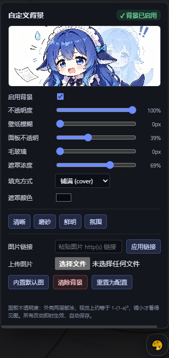

# dsh-shell-wallpaper

给整个 DeepSeek Harness 界面铺一张背景图，并自带一个「边拖边生效」的独立控制面板。

> 本文件是纯中文版说明；[README.md](./README.md) 是中英双语版（npm 页面渲染的是它，本文件在仓库里单独看）。

**插件内置一张默认图**（`assets/default-bg.jpg`），所以全新安装、零配置就能看到背景。用户随时可以换成任意图片（上传 / URL / 本地路径），也可一键切回内置图。

结构上分两半：host 端只通过 HTTP 服务一个文件外加一个 `/info` 描述；client 端把它画到外壳背后、轮询该描述、并画一个浮动 🎨 面板。不依赖 Wallpaper Engine、不处理视频、没有玻璃管线 —— DSH 自带主题和已装的皮肤插件根本不支持 `background-image`，所以这是能跑起来的最小实现。

**为什么面板由我们自己画，而不是交给设置框架**：`dsh-settings` 自己的 README 写着「autoGenerate … 目前没有已发布的客户端这样做」——实时设置服务会发布 schema，但没有任何已发布客户端据此渲染页面。而在这个 profile 上注册自定义设置 slot 曾经导致过整页白屏。所以面板是我们已经验证可用的 client bundle 注入的纯 DOM，包在独立的 `try/catch` 里：它坏了只坏面板，背景照常铺，GUI 不会白屏。

## 安装

从 npm 安装（推荐）：

```powershell
dsh plugin --profile desktop add dsh-shell-wallpaper
```

从源码目录安装（`dsh plugin add 'file:…'` 要求传**绝对路径**）：

```powershell
dsh plugin --profile desktop add 'file:<你克隆这个仓库的目录>'
```

或者直接从 GitHub 仓库装：

```powershell
dsh plugin --profile desktop add 'github:1020252969/dsh-wallpaper'
```

> `dsh` 是宿主自带的 CLI。它可能不在 `PATH` 里，那就用完整路径调用，
> 例如 `& '<DSH 安装目录>\resources\runtime\cli\bin\dsh.cmd' plugin …`。
> `--profile` 换成你自己的 profile 名（默认 profile 是 `desktop`）。

**无需任何配置** —— 自动使用内置的 `assets/default-bg.jpg`。若要指向自己的文件或设定默认值，把配置写进该 profile 的 `cordis.patch.yml`（即 `$DSH_HOME/profiles/<profile>/cordis.patch.yml`）。**必须写完整一整块** —— patch 的一行会整体替换该行的 config，写半块会把缺的键静默重置为默认值：

```yaml
- id: wallpaper
  config:
    enabled: true
    imagePath: ''            # 空 = 用内置默认图
    opacity: 1
    blur: 0
    panelAlpha: 0.35
    backdropBlur: 0
    fill: cover
    scrimColor: '#08090e'
    scrimAlpha: 0.5
```

装完 bundle 后刷新一次页面（client bundle 在页面加载时注入）。之后**全部实时生效**，不用再刷新。

## 控制面板

点右下角 🎨 按钮，面板长这样：



面板包含：

- **状态徽标**（`✓ 背景已启用` / `✗ 已关闭` / `未配置` / `文件缺失`）和**实时预览缩略图**；
- **启用**复选框；
- 五个滑杆 —— 不透明度、壁纸模糊、面板透明、毛玻璃模糊、遮罩浓度 —— 各自显示当前值；
- **填充方式**（铺满 / 完整）、**遮罩颜色**选择器；
- 四档**预设**（清晰 / 磨砂 / 鲜明 / 氛围）；
- **上传**本地图片（JPG/PNG/GIF/WebP/BMP/AVIF），或**粘贴 http(s) 链接**后点「应用链接」；
- **内置默认图** —— 切回插件自带图（同时重新启用背景）；
- **清除背景**（关闭）与**重置为配置**（丢弃所有面板改动）。

每个控件都写 `POST /wallpaper/api/config`，约一秒内就能看到变化，因为绘制端在轮询 `/info`。

### 改动存在哪

面板改动写进 `<wallpaper-dir>/settings.json`（默认 `$DSH_HOME/wallpaper/settings.json`，例如 `~/.dsh/wallpaper/settings.json`），**不写** `cordis.patch.yml`。这个文件是**叠在 profile patch 之上的覆盖层**：

```
read() = normalizeConfig({ ...plainConfig(profile row), ...await store.load() })
```

由此：改动重启后仍在；拖滑杆不会重写 patch（不会引发 config-reload 风暴）；「重置为配置」只是删掉覆盖文件。目录可用 `config.wallpaperDir` 或环境变量 `DSH_WALLPAPER_DIR` 改（测试用后者隔离到临时目录）。

## 配置项

每个字段都是 `volatile()`，因为实时设置服务只能持久化 volatile 字段 —— 非 volatile 字段会让表单以极难察觉的方式变成只读。（虽然我们自己的面板已不依赖那张表单，导出的 `Config` 仍为兼容保留。）

| 字段 | 含义 | 默认值 |
|---|---|---|
| `enabled` | 关掉整个背景但不删配置。 | `true` |
| `imagePath` | 图片绝对路径，**用正斜杠**。空值使用内置的 `assets/default-bg.jpg`。路径错误会安静地失败（控制台警告 + 原生主题）。 | `''` → 内置图 |
| `opacity` | 0–1，图片图层自身的不透明度。 | `1` |
| `blur` | 0–64 px，作用在图片本身。超过约 24 就只是一片颜色。 | `0` |
| `panelAlpha` | 0–1，外壳表面保留多少不透明度，**这是可读性旋钮**；`1` 会把图完全盖住。因为 `_frame` 与 `_centerCol` 两层嵌套都涂，实际观感接近 `1-(1-a)²`。 | `0.35` |
| `backdropBlur` | 0–64 px，给大的外壳表面加 `backdrop-filter`，得到毛玻璃而非平涂色块；`0` = 关闭。 | `0` |
| `fill` | `cover`（铺满）或 `contain`（完整）。 | `cover` |
| `scrimColor` | 遮罩颜色，`#rrggbb` / `rgb()` / `rgba()`，位于图片与 UI 之间。 | `#08090e` |
| `scrimAlpha` | 0–1，遮罩浓度。 | `0.35` |
| `scrim` | 遗留字段：任意 CSS 颜色，仅在 `scrimColor` 无法解析时启用。 | `''` |

## 原理：为什么不是一行 CSS

外壳会给每一层都涂不透明底色。来自 `@deepseek-ai/dsh-client-ui-layout` 的 `AppFrame.module.css`：

```css
.mP3x-q_frame     { background: var(--dsw-alias-bg-base) }
.mP3x-q_centerCol { background: var(--dsw-alias-bg-base) }
.mP3x-q_sidebarCol{ background: var(--dsw-specific-sidebar-fill) }
[data-windows-titlebar] .mP3x-q_frame { background: var(--dsw-specific-sidebar-fill) }
```

所以 `body` 上的 `background-image` 根本看不见。插件改为：

1. 在 `<body>` 上放一个 `position: fixed; z-index: -1` 的图层；
2. 把 `--dsw-alias-bg-base` 与 `--dsw-specific-sidebar-fill` 重新指向 `color-mix(in srgb, <主题基色> <panelAlpha>%, transparent)`；
3. 在 `body[data-ds-dark-theme][data-dsh-wallpaper]` 下**重复一遍这些覆盖 —— 这正是坑所在**。主题包把自己那套调色板样式表**追加在本插件之后**，而 `body[data-ds-dark-theme]` 特异性同为 (0,1,1) 却排在后面，于是把框架重涂成不透明深色、图片消失。深色选择器把特异性抬到 (0,2,1)。

`<主题基色>` 读自 `getComputedStyle(document.body).backgroundColor`，不是读令牌 —— 令牌通常又是另一个 `var()`，直接取值会拿到字面文本。

布局里的类名是 CSS-module 哈希（`mP3x-q_`），随版本变化，所以这里不按哈希匹配；`--dsw-alias-*` 令牌才是稳定契约。毛玻璃面板也是靠几何而非 CSS 找到：`<body>` 下两层以内、覆盖视口 ≥20%、且背景不透明的节点会被打上 `data-dsh-wp-frost`，样式表只对带该属性的节点应用 `backdrop-filter`。

### 保持同步与自愈

`GET /wallpaper/api/info` 带一个 `revision` 字符串，任何旋钮或文件变化都会让它改变。客户端约每秒轮询一次（标签页隐藏时暂停），只在它变化时重画 —— 这既让滑杆实时生效，也意味着原地替换图片无需刷新。面对 v1/v2 的 host，同一个值会由客户端本地从响应推导。

宿主是 SPA：切换对话/主题会追加新样式表，可能把两个令牌重涂成不透明，或把我们的 `<style>` 从 `<head>` 里挤掉 —— 表现为「聊着聊着背景变黑」。以前 revision 不变就跳过重画，于是永远恢复不了。现在每个 tick 都会跑 `selfHeal()`（检查样式/图层/标记是否还在，必要时把我们的样式表挪回 `<head>` 末尾，用 `lastGoodInfo` 重画）。`shellBaseColor()` 只缓存完全不透明的基色，避免反复重画把色调越压越暗。

## 接口

| 路由 | 行为 |
|---|---|
| `GET /wallpaper/api/info` | JSON。无图可画时返回 `ok:false` + `reason`（`disabled` / `missing` / `not-a-file`）+ `error`；`cache-control: no-store`。随包带上四档 `presets` 与 `wallpaperDir` 供面板使用。 |
| `GET\|HEAD /wallpaper/api/image` | 流式返回那个配置文件（或内置默认图）。`ETag` + `If-None-Match` → `304`。**没有任何路径参数**，因此无法读取其它文件。 |
| `POST /wallpaper/api/config` | `{...旋钮}` → 白名单过滤 → 写入 `settings.json`。`{reset:true}` 删除覆盖文件。`{useDefault:true}` 清空 `imagePath`（→ 内置图）并重新启用背景。 |
| `POST /wallpaper/api/clear` | 持久化 `{enabled:false}`。 |
| `POST /wallpaper/api/upload` | `{dataBase64}` → magic-byte 嗅探 → 存为 `wallpaper-<时间>-<随机>.<ext>`（忽略客户端文件名）→ 把 `imagePath` 指过去并启用。上限 12 MB。 |
| `POST /wallpaper/api/import-url` | `{url}` → 下载 → 同样的存盘流程。 |

### URL 导入与 SSRF

`importFromUrl` 刻意做得很严，因为 host 跑在用户自己的机器上：

- 只接受 `http:`/`https:`、URL 里不带凭据、只允许 80/443 端口；
- 抓取前先 `dns.lookup(all)` 解析主机名，**每一个**返回地址都必须通过 `ipIsPrivate()` —— 回环、链路本地、RFC1918、CGNAT、文档保留段、`169.254.169.254` 一类元数据、组播/保留地址，以及 IPv6 `::1`/`fc00::/7`/`fe80::/10`/`::ffff:` 映射地址，一律拒绝；
- 重定向**手动**跟随（`redirect:'manual'`），最多 4 跳，每跳重新校验（防止公网 URL 弹回局域网）；
- 15 秒超时（`AbortController`）；`content-length` 与实际流双重限 12 MB；
- 下载的字节还必须通过 `sniffImage()` —— 绝不按扩展名信任文件。

上传同样严格：`sniffImage()` 只认识 jpg/png/gif/webp/bmp/avif 的真实 magic bytes，其余一律 415；畸形 JSON / 坏 base64 返回 400。

## 已知边界

- **只有一张图。** 没有轮播、没有视频、没有按工作区分别设图。需要这些请装 `dsh-plugin-wallpaper-engine`（1.4.0，约 4.5 MB client bundle + 8 行 host 配置）。
- **实际只适合深色模式。** 遮罩与 `panelAlpha` 默认值是按「深色配色 + 明亮图片」调的；浅色主题下建议 `panelAlpha` 接近 `0.95` 并换更浅的遮罩。
- **毛玻璃面板的判定是启发式的。** 若未来布局把框架嵌到两层以上，就找不到可毛玻璃化的节点，这个设置看起来会像失效。
- **面板是悬浮按钮，不是设置页。** 它刻意独立于设置框架（见开头）。安装后刷新一次页面才会出现。

## 开发

测试运行时需要 `@deepseek-ai/schemastery`，它由宿主 profile 提供。所以源码目录里放了一个 `node_modules` 目录联接（junction），指到你**自己 profile** 的 `node_modules`（把下面的 `<profile>` 换成你的 profile 名，`<DSH_HOME>` 换成你的 DSH 主目录）：

```powershell
New-Item -ItemType Junction -Path '.\node_modules' -Target '<DSH_HOME>\profiles\<profile>\node_modules'
```

然后在仓库目录里跑：

```powershell
node test\host.spec.mjs     # 34 项断言
node test\client.spec.mjs   # 77 项断言
```

client 测试会把 `setInterval` 打桩 —— 真实文件会轮询，不打桩会让 node 永不退出。它还用**薄** DOM（没有 `addEventListener`）跑绘制断言以验证面板优雅降级，用**富** DOM 跑面板断言。host 测试把 `DSH_WALLPAPER_DIR` 指到临时目录，绝不碰真实的 `settings.json`。

## 卸载

```powershell
dsh plugin --profile desktop remove dsh-shell-wallpaper
```

同时把 `cordis.patch.yml` 里的 `- id: wallpaper` 块删掉。没有插件时这行是惰性的（Cordis 会跳过 bundle 缺失的行），但留着就是一份等将来重装时才生效的旧配置。
